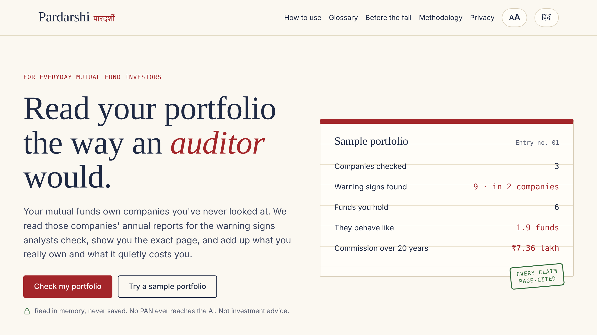
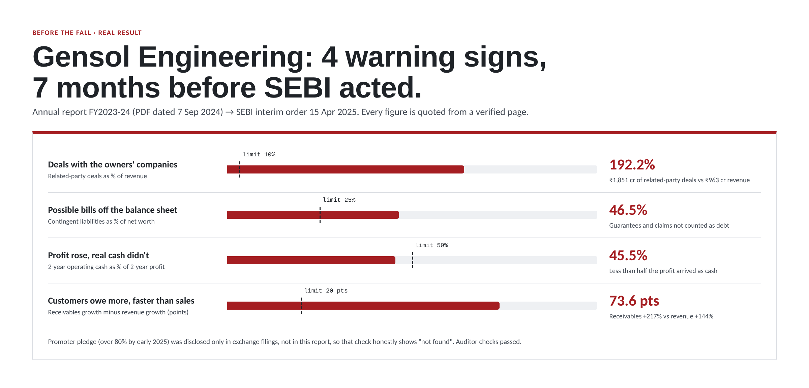
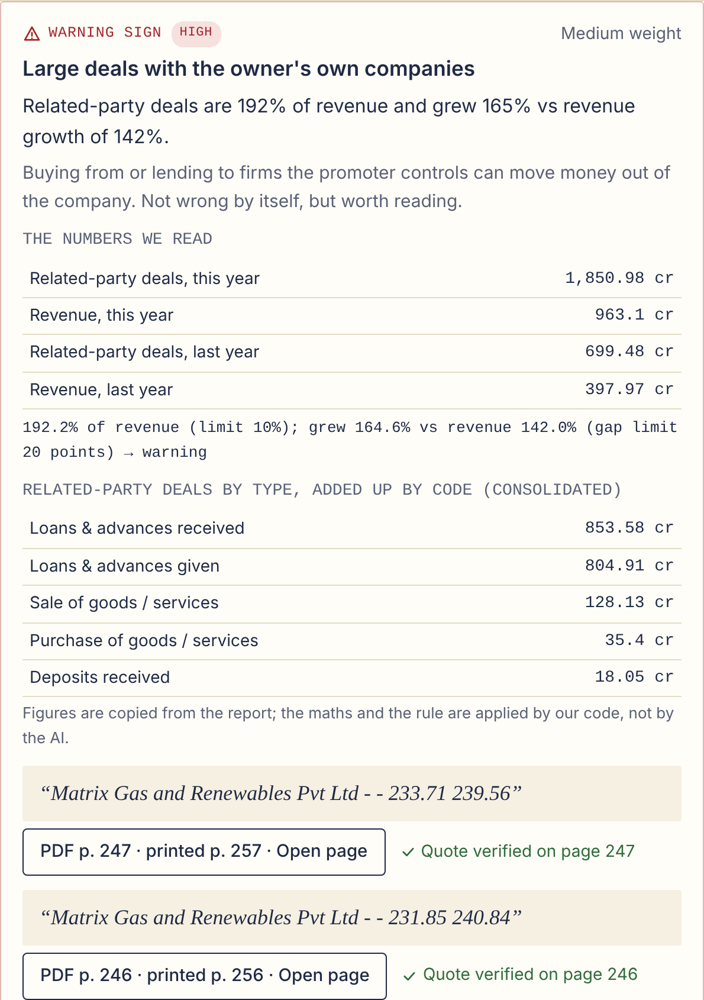
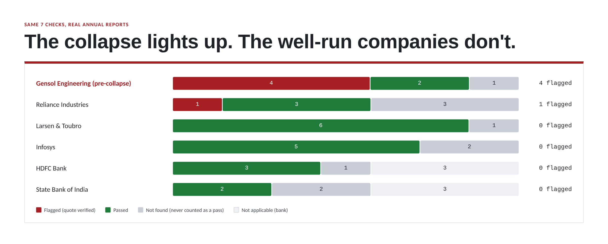
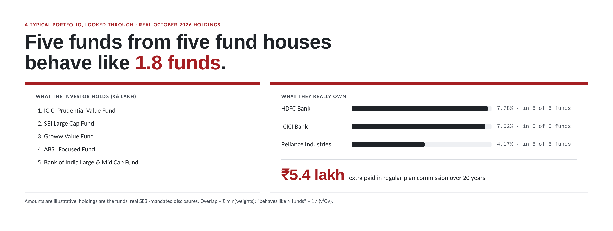
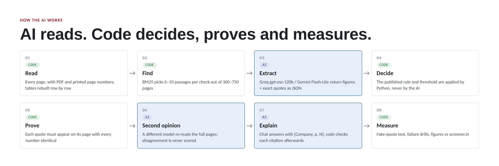

# Pardarshi · पारदर्शी

**Read your mutual fund portfolio the way an auditor would.**

Your mutual funds own companies you've never looked at. Pardarshi **looks through your funds to the companies inside them**, reads those companies' annual reports for seven warning signs that analysts check, and shows you **the exact page and line**, machine-verified. Then it adds up what you really own and what hidden commissions cost you, in plain English or Hindi.

1. **Where the warning signs are:** seven forensic-accounting checks on the annual reports of the companies your funds hold most, each flag with a **verified quote and page number**, plus which of your funds you hold it through.
2. **What you really own:** every company inside every fund, added up. Six funds often hold the same twenty stocks.
3. **What it quietly costs:** the distributor commission hidden in regular plans, in rupees, up to the age you'll need the money.
4. **Before the fall:** a backtest page showing what the checks found in reports filed *before* a company's collapse.

Built for **Arthaton 2026** (AI for finance).

📘 **[User guide (PDF)](docs/guide.pdf)** · 📊 **[Results report (PDF)](docs/report.pdf)**





> Research and educational tool. Not investment advice; not a SEBI-registered adviser. A warning sign is a reason to look closer, never proof of wrongdoing.

---

## Why it's different

Portfolio overlap and fee calculators already exist (several free CAS analysers do this). **Pardarshi's edge is one level deeper:** no retail tool we found looks through an investor's funds to the underlying companies and checks their annual reports, with page-verified evidence and measured accuracy.

| Usual finance tools | Pardarshi |
|---|---|
| Stop at fund-level overlap and XIRR | Look through to the companies and read their annual reports |
| Forensic red-flag tools are built for analysts and CAs | Built for an everyday investor, in plain English or Hindi |
| Overlap checkers compare two funds you type in | Reads your whole statement in one upload |
| Commission calculators are a separate site | Your real loss in rupees, from your own holdings |
| Nobody checks the companies inside your funds | Seven checks on annual reports, with cited pages |
| "Trust us" | Every number has **Show the working**: formula, inputs, data date |
| AI writes the answer | **Code computes every number**; AI only explains and reads text |

## Design principles

- **Numbers are calculated by code, never generated by an LLM.** Exposure, overlap, cost and every red-flag threshold are deterministic Python with unit tests.
- **No unverifiable accusations.** A flag is shown only if its quote is found on the cited page (fuzzy match ≥ 90 **and** every figure in the quote appears exactly on the page). Otherwise it is downgraded to "unverified".
- **Privacy by construction.** The CAS PDF is parsed in memory and dropped; name, PAN, email, phone and folio numbers are removed in the first function that touches the data. The AI never sees them. Nothing is stored server-side.
- **Falls back gracefully.** LLM fallback chain (Azure OpenAI → Gemini → Groq → Mistral → any OpenAI-compatible → local Ollama → answers from saved findings), circuit breakers, timeouts, retries, rate limits, and an offline demo bundled in the frontend.
- **Accessible.** Hindi and English, larger-text toggle, keyboard navigation and focus trapping in drawers, screen-reader labels, table views for every chart, colour never used alone, works at phone width, `prefers-reduced-motion` respected.

## Architecture

```
                         OFFLINE (your laptop, once a month)
  AMFI scheme master ─┐
  Fund house monthly  ├─► pipelines/build_dataset ─► funds.json, companies.json
  portfolio Excel ────┘
  Annual report PDFs ─► pipelines/build_redflags ─► scorecards/<ISIN>.json + chunks/<ISIN>.jsonl
                         (PDF → pages → BM25 [+ dense + reranker] → LLM JSON or regex
                          → rule applied by Python → quote verified on page)

                         ONLINE (per request)
  Browser (Next.js on Vercel)
     │  /api/* (rewrite)            ┌──────────────────────────────────────────┐
     └────────────────────────────► │ FastAPI (Docker on Azure Container Apps) │
                                    │  CAS parse (in memory, PII dropped)      │
                                    │  numpy holdings matrix: exposure,        │
                                    │  overlap, effective funds, fee loss      │
                                    │  cached scorecards + page text           │
                                    │  chat: BM25 retrieval + LLM chain (SSE)  │
                                    └──────────────────────────────────────────┘
```

All fund holdings are packed into one dense `funds × stocks` weight matrix at startup, so a full analysis is a few vectorised numpy operations: sub-second responses (about 4 ms of server time when idle, measured in-process).

### Measured (2 vCPU sandbox, load generator on the same machine)

| | Result |
|---|---|
| Full portfolio analysis, idle | ~4 ms server time |
| 50 concurrent users × 30 requests | **477 req/s**, 0 errors, p50 97 ms, p95 175 ms end to end |
| Rate limiting | 30/min per IP on analysis, 10/min on uploads, 20/min on chat (configurable) |

## The maths

- **Exposure** to a stock = Σ over funds (your value in fund × fund's weight in stock)
- **Overlap**(A,B) = Σ over stocks min(w_A, w_B), weights normalised to each fund's equity book
- **Behaves like N funds** = 1 / (vᵀ O v), where v is the share of your money in each fund and O the overlap matrix (1 on the diagonal). All-identical funds give 1; fully distinct funds give the inverse Herfindahl of your allocation.
- **Commission loss** = V(1 + r − TER_direct)ⁿ − V(1 + r − TER_regular)ⁿ

## The seven checks

| Check | Rule (flag if…) |
|---|---|
| Auditor raised concerns | qualified / adverse / disclaimer of opinion, or going-concern uncertainty |
| Auditor resigned mid-term | statutory auditor resignation or casual vacancy |
| Owners borrowed against shares | > 10% of promoter holding pledged |
| Deals with the owner's companies | related-party transactions > 10% of revenue, or growing 20 pp faster than revenue |
| Big possible bills off the balance sheet | contingent liabilities > 25% of net worth |
| Profit rose, real cash didn't | 2-year operating cash flow < 50% of 2-year profit, or cash fell while profit rose |
| Customers owe more, faster than sales | receivables growth − revenue growth > 20 pp |

## Results on real data (November 2026)

**Data:** 242 real schemes from 8 fund houses (October 2026 disclosures), 1,072 companies, and annual reports of HDFC Bank, Reliance, SBI, L&T, Infosys and Gensol Engineering (300–750 pages each).

### Before the fall: Gensol Engineering

We ran the seven checks on Gensol's **FY2023-24 annual report, published in September 2024**, before SEBI's interim order of **15 April 2025** (alleged diversion of borrowed funds; the share fell over 90%).

| Check | What the pre-collapse report showed | Rule |
|---|---|---|
| Deals with the owners' companies | Related-party transactions **₹1,851 cr = 192% of revenue** (₹963 cr); loans & advances **given** to related parties alone ₹805 cr, up from ₹242 cr; parties include Matrix Gas & Renewables, Gensol Consultants, Gosolar Ventures and **Blu-Smart Fleet** (₹139 cr, p. 246) | > 10% of revenue |
| Possible bills off the balance sheet | Contingent liabilities **46.5%** of net worth | > 25% |
| Profit rose, real cash didn't | 2-year operating cash flow **45%** of 2-year profit | < 50% |
| Customers owe more, faster than sales | Receivables **+217%** vs revenue **+144%** | gap > 20 pp |
| Auditor concerns / auditor resigned | Not triggered | |
| Promoters pledged shares | **Not found: the annual report does not state it.** The pledge (over 80% of promoter holding by early 2025) was disclosed only in quarterly exchange filings, which is why exchange filings are first on our roadmap | > 10% |



The related-party total has no single line in the report; **code adds up every row** of the transactions table (directors' pay excluded) and quotes the largest rows. Each quote is verified on its page, and a second AI model re-checks every warning.

### Two more collapses: what one annual report could not show

We ran the same seven checks, unchanged, on two more companies' last reports before their collapse. **Neither produced a confirmed warning: 1 of 3 collapses caught.** We publish the misses instead of tuning rules to three known answers.

| Company (report) | Later | What the checks did |
|---|---|---|
| Coffee Day Enterprises (FY2017-18) | Founder's death, July 2019; a probe later found ₹3,535 cr moved to a promoter-controlled company | The AI read promoter pledge as 62.3%, but its quote showed only total promoter holding; **the second model rejected it, so no warning was shown** (maybe true, not proven on the page). Related party not found; 5 checks passed |
| Brightcom Group (FY2021-22) | SEBI interim order on misstated accounts, April 2023 | No warnings. Cash at 7,519% of profit was a units mix-up, now "figures don't add up, not scored". 3 checks not found. Misstated accounts give single-year checks little to catch |

Both point to the same next step: compare several years of reports, and read exchange filings.

### The same checks on large, well-run companies



| Company | Flagged | Passed | Not found | Not applicable (bank) |
|---|---|---|---|---|
| Larsen & Toubro | 0 | 6 | 1 | – |
| Infosys | 0 | 5 | 2 | – |
| HDFC Bank | 0 | 3 | 1 | 3 |
| State Bank of India | 0 | 2 | 2 | 3 |
| Reliance Industries | 1 (receivables +39% vs revenue +10%; second model agreed) | 3 | 3 | – |
| **Gensol (pre-collapse)** | **4** (3 confirmed by the second model, 1 disputed) | 2 | 1 | – |

A warning sign is a reason to look closer, not proof: Reliance's receivables flag is real arithmetic but may have an ordinary business explanation, which the evidence drawer's caveat explains.

### A typical portfolio, looked through



Five popular **actively managed** funds from **five different fund houses** (ICICI Prudential Value, SBI Large Cap, Groww Value, ABSL Focused, Bank of India Large & Mid Cap; made-up amounts totalling ₹6 lakh):

- They **behave like 1.8 funds**: HDFC Bank (7.8% of the money), ICICI Bank (7.6%) and Reliance (4.2%) are held by **all five**.
- Regular plans cost about **₹5.4 lakh** more than direct plans over 20 years (at 12% gross return).

### Reliability


- **Fake-quote guard:** 97.1% of deliberately altered quotes rejected; genuine quotes accepted.
- **Failure drills:** 6 of 6 passed (AI down, rate-limited, timeouts → the app still answers from verified findings).
- **Second AI model** agreed with 4 of 6 warning signs in the latest run; the 2 disagreements are shown as "Models disagree" and not scored.
- **Figures vs an independent source:** 23 of 28 extracted figures (82%) equal a figure published on screener.in; 6 of those carried the wrong standalone/consolidated label, and one check (L&T cash vs profit) mixed the two bases (it still passes on consolidated figures, 71%). The 5 mismatches: 2 equity figures that appear to include minority interests, 1 standalone equity figure with no standalone reference, and 2 Reliance revenue figures that match neither basis. Basis-consistency checking is the next fix.
- **Impossible results caught:** a ratio beyond ±1,000% (Brightcom's cash at 7,519% of profit, a units mix-up) is shown as "figures don't add up, not scored", never as healthy.
- 91 automated tests.

## How the AI works



| # | Step | Who | What happens |
|---|---|---|---|
| 1 | Read | code | Every page kept with PDF and printed page number, plus a **table-aware view** rebuilt from word positions so each table row keeps its label and figures together (`Trade receivables \| 1,234.50 \| 1,100.20`); plain PDF text puts every cell on its own line |
| 2 | Find | code | BM25 (+ optional embeddings/reranker) picks 6–10 passages per check out of 300–700 pages; number checks search the table-aware view |
| 3 | Extract | **AI** | Groq `openai/gpt-oss-120b` (fallback: Gemini `gemini-flash-lite-latest`) returns figures/verdicts as JSON with exact quotes and pages, using check-specific guidance |
| 4 | Decide | code | Published rule and threshold applied by code; the AI never decides a warning alone |
| 5 | Prove | code | Every quote matched on its page, every number identical; otherwise "Unverified" and never shown |
| 6 | Second opinion | **AI** | A *different* model re-reads the full cited pages; if it disagrees the finding becomes "Models disagree" and is not shown or scored |
| 7 | Backup | code | When the AI is rate-limited or down, a rule-based reader fills in only what it can prove |
| 8 | Explain | **AI** | Chat answers from retrieved passages + code-calculated numbers with `[Company, p. N]` citations; code then checks each citation and figure against the page |
| 9 | Measure | code | Stage by stage against hand labels: **retrieval** (was the answer page among the passages?), **evidence** (right page cited?), **verdict** (precision, recall, F1, missed-warning rate); plus fake-quote test and failure drills (`make_label_sheet`, `evaluate_flags`, `benchmark`) |

**AI models and APIs used:** Groq API (`openai/gpt-oss-120b`), Google Gemini API (`gemini-flash-lite-latest`); optional Mistral API and any OpenAI-compatible endpoint or local Ollama. Optional local models for retrieval: `BAAI/bge-base-en-v1.5` and `BAAI/bge-reranker-base`.

## Scoring and severity

- **Severity per warning sign:** High, Moderate or Low, from the check's weight and how far past the published threshold the figures are (e.g. 12% pledged is Low; 45% is High).
- **Transparency Score (0–100):** each company starts at 100 and loses 30 / 15 / 5 points per High / Moderate / Low quote-verified warning sign; the portfolio score is the rupee-weighted average over the companies we have read, always shown with coverage. It measures warning signs in annual reports, not returns or safety.
- **Across years:** the same seven checks per financial year, with a worse/better trend per check.

## Limitations

- Only Indian company shares inside funds are checked; debt, gold, overseas and fund-of-funds holdings are not.
- Annual reports come once a year, so a warning reflects the latest report, not this week's news.
- Only companies whose reports have been processed are checked; every report states how much of your money that covers.
- The AI can miss information that is worded unusually or sits in images. Misses show as "Not found", never as a pass.
- For banks, lenders and insurers, three checks built for ordinary businesses are marked "Not applicable".
- Thresholds are simple published rules, not a full credit analysis. A warning sign is a reason to look closer, not proof of wrongdoing.

## Run it locally

```bash
# backend
cd backend
pip install -r requirements-dev.txt
python -m pipelines.make_sample_data          # fictional demo dataset + 3 synthetic annual reports
python -m pipelines.build_redflags --no-llm   # run the real red-flag pipeline on them
pytest -q                                     # 63 tests
uvicorn app.main:app --reload --port 8000

# frontend (new terminal)
cd frontend
npm install
npm run dev                                   # http://localhost:3000, /api proxied to :8000
```

Add an LLM key to `backend/.env` (see `.env.example`) to switch on AI answers and LLM extraction. Without one, everything still works: chat returns the verified findings and most relevant report passages.

## Use real data

All the inputs are public: AMFI's scheme list and TER disclosures, fund houses' SEBI-mandated monthly portfolio files, and companies' annual reports. **[docs/REAL_DATA.md](docs/REAL_DATA.md)** is a step-by-step checklist; in short:

```bash
cd backend && pip install -r requirements-pipeline.txt
python -m pipelines.fetch_amfi                     # AMFI scheme master
#   save AMFI's TER download as data/raw/ter.xlsx; fund-house portfolio files in data/raw/portfolios/
python -m pipelines.parse_amc_portfolios           # xlsx / xls / xlsb / zip, messy layouts
python -m pipelines.build_dataset --sample         # funds.json, companies.json, reports_needed.csv
python -m pipelines.rename_reports ~/Downloads/ar  # files PDFs as data/reports/<ISIN>.pdf
python -m pipelines.build_redflags --dense --pause 4   # resumable; LLM + local embeddings/reranker
python -m pipelines.evaluate_flags                 # precision / recall vs your hand labels
python -m pipelines.review_flags                    # a second AI model re-checks every warning sign
python -m pipelines.benchmark --live               # citation guard, failure drills, speed, live AI timing
python -m pipelines.report_list                    # which annual reports to download next
python -m pipelines.validate_dataset               # must print OK
python -m pipelines.export_demo ../frontend/public/demo
```

## Deploy

See **[docs/DEPLOY.md](docs/DEPLOY.md)**: frontend on Vercel, API on Azure Container Apps (no local Docker needed), or both on Azure.

## Repository layout

```
backend/
  app/            FastAPI app: portfolio maths, CAS parsing, LLM chain, chat, red-flag engine
  pipelines/      offline data + red-flag build scripts
  data/           real fund holdings, scorecards and page text; fictional demo set for tests
  tests/          unit + API tests (maths, rules, citation verification, fallbacks, privacy)
  Dockerfile
frontend/         Next.js 16 app (ledger design), offline demo in public/demo
docs/             deploy guide, demo-video script
```

## Credits

Open-source libraries: FastAPI, Uvicorn, Pydantic, NumPy, pandas, httpx, rank-bm25, RapidFuzz, PyMuPDF, casparser, SlowAPI, sentence-transformers and the BAAI bge models (optional, offline), pytest; Next.js, React, TypeScript. Fonts: Instrument Serif, IBM Plex Sans / Sans Devanagari / Mono, Tiro Devanagari Hindi (Google Fonts, SIL OFL).

AI APIs (optional, configurable): Azure OpenAI, Google Gemini, Groq, Ollama. Built with help from Claude (Anthropic).

Data sources for real deployments: AMFI scheme and TER disclosures, fund houses' SEBI-mandated monthly portfolio disclosures, companies' annual reports filed with BSE/NSE. This repository ships the real October 2026 fund holdings and the page text and results for the six annual reports above (all public disclosures; the PDFs themselves are not committed, each card links to the original), plus a small fictional demo set (ISINs starting with `ZZDEMO`) used by the tests.

## What's next

From an external technical review, in priority order:

- **Sector-relative thresholds** (e.g. contingent liabilities are normal in infrastructure), derived from sector medians across many reports rather than invented; today we only skip three checks for banks, NBFCs and insurers.
- **Fresher signals from exchange filings:** auditor resignations (filed within days under SEBI LODR), credit-rating actions and promoter pledge disclosures (SAST), so a warning doesn't wait for the next annual report.
- **Docling table structure** (optional, GPU) for the few pages where the row view still mixes columns.
- **A larger labelled set** (10+ companies × 7 checks) and a statistical backtest across many past collapses, not only case studies.

- Peer comparison within each sector, so normal industry behaviour isn't read as a warning.
- A visual map from funds to companies to warning signs, and a two-fund comparison view.
- Automatic monthly refresh of fund holdings and new annual reports.

## License

MIT
