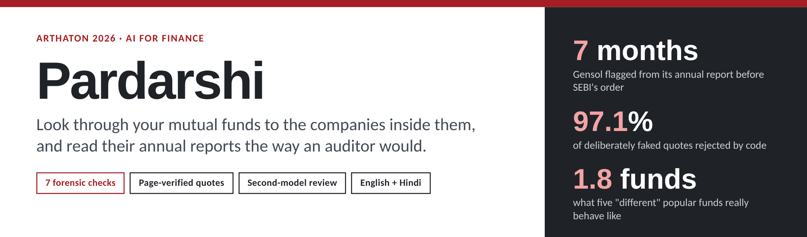
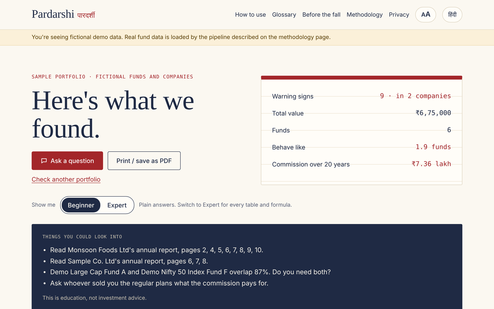
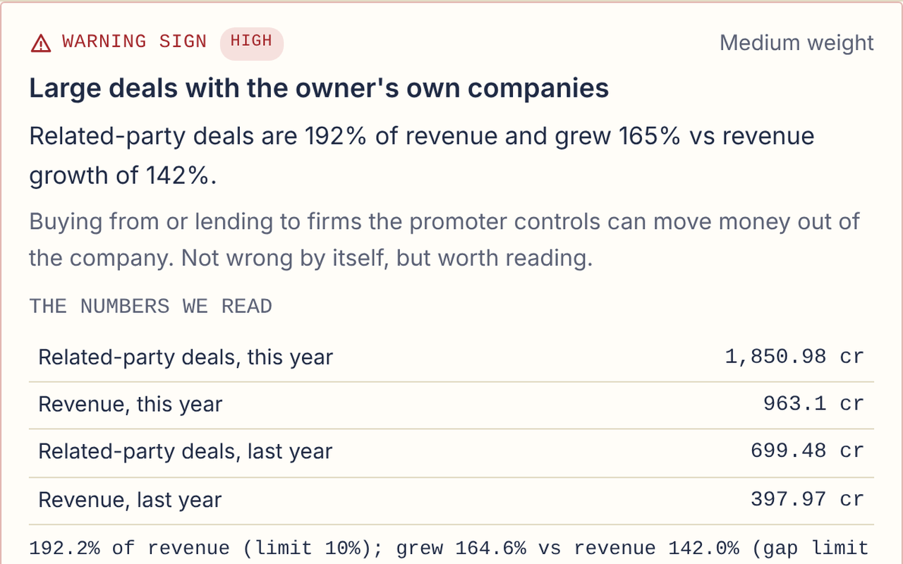
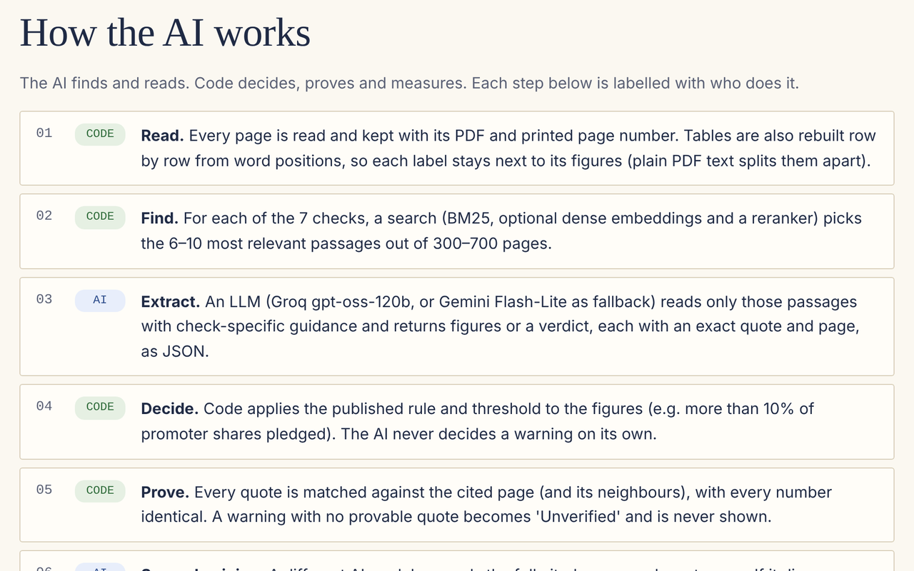
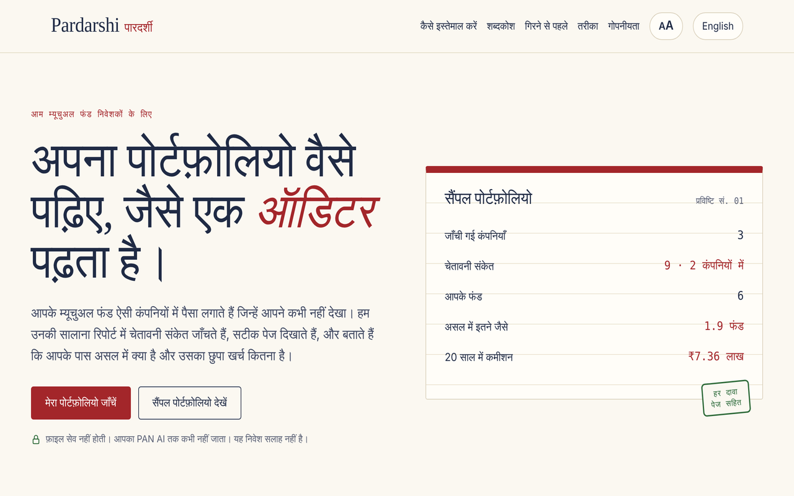
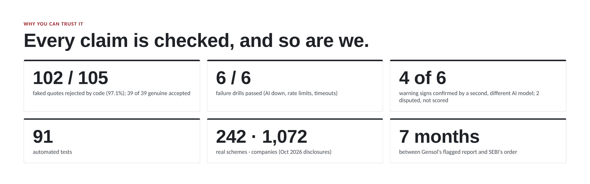

<div align="center">



<h3>Your mutual funds own companies you've never looked at. Pardarshi reads their annual reports for you,<br>and shows the exact page and line behind every warning.</h3>


**[🌐 Live app](https://pardarshi-web.delightfultree-9cf66c96.koreacentral.azurecontainerapps.io)** &nbsp;·&nbsp;
**[▶ Demo video](https://youtu.be/REPLACE_WITH_VIDEO_ID)** &nbsp;·&nbsp;
**[📘 User guide](docs/guide.pdf)** &nbsp;·&nbsp;
**[📊 Technical report](docs/report.pdf)** &nbsp;·&nbsp;
**[🚀 Run it](#run-it)** &nbsp;·&nbsp;
**[🤖 How the AI works](#how-the-ai-works)**

</div>

> [!NOTE]
> A research and education tool, **not investment advice** and not a SEBI-registered adviser. A warning sign is a reason to look closer, never proof of wrongdoing.

---

## 📌 Contents

| | | |
|---|---|---|
| [What it does](#what-it-does) | [Results on real data](#results) | [How the AI works](#how-the-ai-works) |
| [Why it's different](#why-different) | [Reliability, measured](#reliability) | [The AI copilot](#copilot) |
| [Run it in 5 minutes](#run-it) | [Architecture](#architecture) | [Limitations](#limitations) |

---

<a id="what-it-does"></a>

## 🔍 What it does

Upload your mutual fund statement (CAS PDF), pick funds by name, or try the sample. In seconds you get:

| | | |
|:---:|:---:|:---:|
| **🚩 Where the warning signs are** | **🧩 What you really own** | **💸 What it quietly costs** |
| Seven forensic-accounting checks on the annual reports of the companies your funds hold, each warning with a **quote verified on its page** | Every company inside every fund, added up. Five "different" funds often behave like fewer than two | The commission hidden in regular plans, **in rupees**, up to the age you'll need the money |

Plus a **Before the fall** page that runs the same checks on reports filed *before* a company collapsed, and an **AI copilot** you can question in English or Hindi.

<table>
<tr>
<td width="50%"><br><sub><b>Portfolio report</b>: warning signs, overlap, commission, next steps</sub></td>
<td width="50%"><br><sub><b>Evidence</b>: the rule, the figures, verified quotes, AI trace</sub></td>
</tr>
<tr>
<td width="50%"><br><sub><b>Methodology</b>: every AI step labelled with who does it</sub></td>
<td width="50%"><br><sub><b>हिंदी</b>: the whole app in Hindi, plus a larger-text mode</sub></td>
</tr>
</table>

---

<a id="why-different"></a>

## ✨ Why it's different

Portfolio-overlap and fee calculators already exist. **Pardarshi goes one level deeper**: no retail tool we found looks through an investor's funds to the underlying companies and checks their annual reports, with page-verified evidence and measured accuracy.

| Usual finance tools | Pardarshi |
|---|---|
| Stop at fund-level overlap and returns | Look through to the companies and **read their annual reports** |
| Forensic red-flag tools are built for analysts | Built for everyday investors, in **plain English or Hindi** |
| AI writes the answer | **Code computes every number**; AI reads text and explains |
| "Trust us" | Every number has **Show the working**; every warning has a **verified quote and page** |
| A chatbot that will say anything | A copilot with **guardrails enforced by code** before any model is called |

**Design principles**
- 🧮 **Numbers come from code, never from an LLM.** Exposure, overlap, cost and every threshold are deterministic Python with unit tests.
- 🔎 **No unverifiable accusations.** A warning is shown only if its quote is found on the cited page (fuzzy match ≥ 90 **and** every figure identical). Otherwise: "Unverified", never shown.
- 🔒 **Privacy by construction.** The statement is parsed in memory and dropped; name, PAN, email, phone and folio are removed in the first function that touches the data. No AI ever sees them. Nothing is stored.
- 🛟 **Never a blank screen.** Model fallback chain, circuit breakers, rate-limit-aware retries, a rule-based backup reader, and an offline demo bundled in the frontend.
- ♿ **Accessible.** Hindi and English, larger text, keyboard and screen-reader support, table views for every chart, colour never used alone.

---

<a id="results"></a>

## 📈 Results on real data

**242** real schemes from 8 fund houses (October 2026 disclosures) · **1,072** companies · annual reports of HDFC Bank, Reliance, SBI, L&T, Infosys, Gensol, Coffee Day and Brightcom (175–750 pages each).

### Before the fall: Gensol Engineering


Gensol's **FY2023-24 annual report** was public from **September 2024**. SEBI's interim order came on **15 April 2025** (alleged diversion of borrowed funds; the share fell over 90%). Using only that report:

| Check | What the pre-collapse report showed | Rule |
|---|---|---|
| 🔴 Deals with the owners' companies | Related-party transactions **₹1,851 cr = 192% of revenue** (₹963 cr); loans **given** to related parties ₹805 cr, up from ₹242 cr, incl. **Blu-Smart Fleet** ₹139 cr (p. 246) | > 10% of revenue |
| 🔴 Possible bills off the balance sheet | Contingent liabilities **46.5%** of net worth | > 25% |
| 🔴 Profit rose, real cash didn't | 2-year operating cash **45%** of 2-year profit | < 50% |
| 🟠 Customers owe more, faster than sales | Receivables **+217%** vs revenue **+144%** | gap > 20 pp |
| ⚪ Auditor concerns / resignation | Not triggered | |
| ⚪ Promoters pledged shares | **Not in the annual report.** The 80%+ pledge was disclosed only in exchange filings, so the check honestly says "Not found" | > 10% |

The related-party total has no single line in the report: **code adds up every row** of the transactions table (directors' pay excluded) and quotes the largest rows. A second, different AI model confirmed 3 of the 4 warnings and disputed 1, which is shown as "Models disagree" and not scored.

### Two more collapses: what one annual report could not show

We ran the same checks, **unchanged**, on two more companies' last reports before their collapse. **1 of 3 collapses caught.** We publish the misses rather than tune the rules to three known answers.

| Company (report) | What happened later | What the checks did |
|---|---|---|
| Coffee Day Enterprises (FY2017-18) | Founder's death, July 2019; a probe later found ₹3,535 cr moved to a promoter-controlled company | The AI read promoter pledge as 62.3%, but its quote showed only total holding: **the second model rejected it, so no warning was shown.** Maybe true; not proven on the page |
| Brightcom Group (FY2021-22) | SEBI interim order on misstated accounts, April 2023 | No warnings. Cash at 7,519% of profit was a units mix-up, now shown as "figures don't add up, not scored" |

Both are limits of reading **one year's report**: it cannot show a slow build-up over years, and accounts that are themselves misstated cannot be caught from their own figures.

### The same checks on large, well-run companies


| Company | Flagged | Passed | Not found | Not applicable (bank) |
|---|:---:|:---:|:---:|:---:|
| Larsen & Toubro | 0 | 6 | 1 | – |
| Infosys | 0 | 5 | 2 | – |
| HDFC Bank | 0 | 3 | 1 | 3 |
| State Bank of India | 0 | 2 | 2 | 3 |
| Reliance Industries | 1 · receivables +39% vs revenue +10% (second model agreed) | 3 | 3 | – |
| **Gensol (pre-collapse)** | **4** · 3 confirmed, 1 disputed | 2 | 1 | – |

### A typical portfolio, looked through


Five popular **actively managed** funds from **five different fund houses** (ICICI Prudential Value, SBI Large Cap, Groww Value, ABSL Focused, Bank of India Large & Mid Cap; illustrative ₹6 lakh):
- They **behave like 1.8 funds**: HDFC Bank (7.8% of the money), ICICI Bank (7.6%) and Reliance (4.2%) are held by **all five**.
- Regular plans cost about **₹5.4 lakh** more than direct plans over 20 years (12% gross return).

---

<a id="reliability"></a>

## ✅ Reliability, measured



| Test | Result |
|---|---|
| **Fake-quote guard**: genuine quotes and altered ones (numbers, words, pages) | **97.1%** of altered quotes rejected; genuine accepted |
| **Failure drills**: AI down, rate-limited, timeouts, no key | **6 / 6** passed; answers from verified findings |
| **Second AI model** re-reads the full cited pages | Agreed with **4 of 6** warnings; the 2 disputed are shown, not scored |
| **Figures vs an independent source** (screener.in) | **23 of 28 (82%)** are real published figures; 6 had the wrong standalone/consolidated label |
| **Impossible results** | A ratio beyond ±1,000% is "figures don't add up, not scored", never "healthy" |
| **Speed** (2 vCPU) | ~4 ms per analysis; **477 req/s** at 50 concurrent users, 0 errors, p95 175 ms |
| **Automated tests** | **91**, run with all API keys blanked |

<details>
<summary><b>Figure-check details</b></summary>

The 5 mismatches: 2 equity figures that appear to include minority interests (Reliance, L&T), 1 Gensol standalone equity figure with only a consolidated reference, and 2 Reliance revenue figures that match neither basis (the receivables check used the correct ₹10.76 lakh cr). One check, L&T cash vs profit, mixed standalone and consolidated figures; on consolidated figures alone it is 71% and still passes.
</details>

---

<a id="how-the-ai-works"></a>

## 🤖 How the AI works


**The AI reads; code decides, proves and measures.**

| # | Step | Who | What happens |
|:---:|---|:---:|---|
| 1 | Read | code | Every page kept with PDF and printed page number, plus a **table-aware view** rebuilt from word positions so each row keeps its label and figures together |
| 2 | Find | code | BM25 (+ optional embeddings and reranker) picks 6–10 passages per check from 300–700 pages |
| 3 | Extract | **AI** | Groq `openai/gpt-oss-120b` (fallback Gemini `gemini-flash-lite-latest`) returns figures as JSON with exact quotes and pages |
| 4 | Decide | code | The published rule and threshold are applied by code; the AI never decides a warning alone |
| 5 | Prove | code | Every quote matched on its page, every number identical; otherwise "Unverified" |
| 6 | Second opinion | **AI** | A *different* model re-reads the full cited pages; if it disagrees, "Models disagree" and not scored |
| 7 | Backup | code | When the AI is rate-limited or down, a rule-based reader fills in only what it can prove |
| 8 | Explain | **AI** | The copilot answers from retrieved passages and code-computed numbers, with `[Company, p. N]` citations that code then checks |
| 9 | Measure | code | Stage metrics against hand labels (retrieval, cited page, verdict), the fake-quote test and failure drills |

In the app, every warning has an **AI trace** panel showing these steps for that check: passages searched, model used, quote verification, second-model verdict and time taken.

### AI models and APIs used

| Model / API | Used for |
|---|---|
| **Groq API**, `openai/gpt-oss-120b` | Reading report passages into figures and quotes; copilot answers |
| **Google Gemini API**, `gemini-flash-lite-latest` | Fallback reader; second-opinion reviewer |
| Optional: `BAAI/bge-base-en-v1.5`, `BAAI/bge-reranker-base` (local) | Dense retrieval and reranking |
| Optional: Azure OpenAI, Mistral, any OpenAI-compatible endpoint, local Ollama | Extra providers in the fallback chain |

Both default APIs have free tiers; the app works without any key (answers come from verified findings).

---

<a id="copilot"></a>

## 💬 The AI copilot, with guardrails

Ask about your own report in English or Hindi. The rules that matter are enforced **by code, before any model is called**, so no prompt can talk the model out of them.

| Guardrail | What happens |
|---|---|
| 🚫 Buy / sell / price questions | A fixed reply pointing to the evidence instead, in ~3 ms, with no AI call |
| 🔒 PAN, phone, email, folio in a question | Removed before anything is sent |
| 🧱 Prompt injection in report text | Instruction-like lines dropped; passages treated as data |
| ✔️ Citations | Every page and number in an answer checked against the reports |
| ⏱️ Waiting | Live stages, then a **"where the time went"** bar: search (code), AI thinking, AI writing, check (code) |
| 💰 Cost | Per-visitor rate limits, daily AI caps, cached answers, concurrency caps ([details](docs/DEPLOY.md#cost-on-student-credit-how-not-to-get-overcharged)) |

---

<a id="run-it"></a>

## 🚀 Run it in 5 minutes

The repository ships real fund holdings and the results for all eight annual reports, so **the app runs without any API key**.

**Backend** (Python 3.12)
```bash
git clone https://github.com/vika-spec/Pardarshi.git && cd Pardarshi/backend
python -m venv .venv
.venv\Scripts\activate            # Windows  (macOS/Linux: source .venv/bin/activate)
pip install -r requirements-dev.txt
pytest -q                          # 91 tests
uvicorn app.main:app --reload --port 8000
```

**Frontend** (Node 20+, new terminal)
```bash
cd frontend
npm install
npm run dev                        # open http://localhost:3000
```

**Turn on AI (optional, free):** copy `backend/.env.example` to `backend/.env` and add `GROQ_API_KEY` and/or `GEMINI_API_KEY`, then restart the backend.

<details>
<summary><b>Rebuild the data and results yourself</b></summary>

All inputs are public: AMFI's scheme list and TER disclosures, fund houses' monthly portfolio files, and companies' annual reports. Step-by-step: **[docs/REAL_DATA.md](docs/REAL_DATA.md)**.

```bash
cd backend && pip install -r requirements-pipeline.txt
python -m pipelines.fetch_amfi                     # AMFI scheme master
python -m pipelines.parse_amc_portfolios           # fund-house portfolio files
python -m pipelines.build_dataset --sample         # funds.json, companies.json
python -m pipelines.rename_reports <folder>        # file PDFs as data/reports/<ISIN>.pdf
python -m pipelines.build_redflags --pause 0       # retrieval → AI → rules → proof
python -m pipelines.review_flags                   # second model re-checks every warning
python -m pipelines.check_figures                  # extracted figures vs screener.in
python -m pipelines.reapply_rules                  # re-decide from stored figures, no AI calls
python -m pipelines.benchmark --live               # fake-quote guard, failure drills, speed
python -m pipelines.export_demo                    # offline demo for the frontend
```
</details>

<details>
<summary><b>Deploy</b></summary>

Live on **Azure Container Apps** ([pardarshi-web](https://pardarshi-web.delightfultree-9cf66c96.koreacentral.azurecontainerapps.io)): the web app and the API run as two small containers, with every cost capped for student credit. Vercel also works for the frontend. See **[docs/DEPLOY.md](docs/DEPLOY.md)**.
</details>

---

<a id="architecture"></a>

## 🏗️ Architecture

```
  OFFLINE (monthly)                                ONLINE (per request)
  ─────────────────                                ────────────────────
  AMFI + fund-house portfolios ─► build_dataset    Browser (Next.js, EN/HI)
  Annual-report PDFs ─► build_redflags                  │  /api/*
     PDF → pages + table rows → BM25                    ▼
     → AI JSON → rule in Python                    FastAPI
     → quote verified on page                        ├ CAS parse in memory, PII dropped
     → second-model review                           ├ numpy funds × stocks matrix:
           │                                         │   exposure, overlap, cost
           ▼                                         ├ cached scorecards + page text
  scorecards/<ISIN>.json, page text ───────────────► └ copilot: guardrails → BM25 → AI (SSE)
                                                         → citation check
```

All holdings are packed into one `funds × stocks` matrix at startup, so a full analysis is a few vectorised operations (~4 ms).

<details>
<summary><b>The maths</b></summary>

- **Exposure** to a stock = Σ over funds (your value in fund × fund's weight in stock)
- **Overlap**(A,B) = Σ over stocks min(w_A, w_B), weights normalised to each fund's equity book
- **Behaves like N funds** = 1 / (vᵀ O v), with v your share of money in each fund and O the overlap matrix. Identical funds give 1; fully distinct funds give the inverse Herfindahl of your allocation
- **Commission loss** = V(1 + r − TER_direct)ⁿ − V(1 + r − TER_regular)ⁿ
</details>

<details>
<summary><b>The seven checks and scoring</b></summary>

| Check | Flag if… |
|---|---|
| Auditor raised concerns | qualified / adverse / disclaimer of opinion, or going-concern doubt |
| Auditor resigned mid-term | statutory auditor resignation or casual vacancy |
| Owners borrowed against shares | > 10% of promoter holding pledged |
| Deals with the owners' companies | related-party transactions > 10% of revenue, or growing 20 pp faster than revenue |
| Big possible bills off the balance sheet | contingent liabilities > 25% of net worth |
| Profit rose, real cash didn't | 2-year operating cash < 50% of 2-year profit, or cash fell while profit rose (and cash < profit) |
| Customers owe more, faster than sales | receivables growth − revenue growth > 20 pp |

**Severity:** High (≥ 3× past the limit), Moderate (1.5–3×), Low (< 1.5×). **Transparency Score:** each company starts at 100 and loses 30 / 15 / 5 per High / Moderate / Low verified warning; the portfolio score is rupee-weighted and always shown with coverage. Banks and insurers skip three checks built for ordinary businesses.
</details>

<details>
<summary><b>Repository layout</b></summary>

```
backend/
  app/          FastAPI: portfolio maths, CAS parsing, LLM chain, copilot, red-flag engine, cost guards
  pipelines/    offline data, red-flag build, review, evaluation scripts
  data/         real fund holdings, scorecards and page text; fictional demo set (ZZDEMO…) for tests
  eval/         reference figures and evaluation outputs
  tests/        91 unit and API tests
frontend/       Next.js app; offline demo in public/demo
docs/           user guide, technical report, deploy guide, images
```
</details>

---

<a id="limitations"></a>

## ⚠️ Limitations

- Only Indian company shares inside funds are checked; debt, gold and overseas holdings are not.
- Annual reports come once a year; a warning reflects the latest report, not this week's news.
- Only processed reports are checked, and every result states how much of your money that covers.
- The AI can miss information worded unusually or inside images: that shows as "Not found", never as a pass.
- Fixed published thresholds, not yet relative to sector norms. Three collapse cases are case studies, not a statistical backtest.

---

## 🙏 Credits

**Libraries:** FastAPI, Uvicorn, Pydantic, NumPy, pandas, httpx, rank-bm25, RapidFuzz, PyMuPDF, casparser, SlowAPI, sentence-transformers (optional), pytest; Next.js, React, TypeScript. **Fonts:** Instrument Serif, IBM Plex Sans / Sans Devanagari / Mono, Tiro Devanagari Hindi (SIL OFL).
**AI APIs:** Groq, Google Gemini (optional: Azure OpenAI, Mistral, Ollama). Built with help from Claude (Anthropic).
**Data:** AMFI scheme and TER disclosures; fund houses' SEBI-mandated monthly portfolio disclosures; companies' annual reports filed with BSE/NSE; screener.in for reference figures. Report PDFs are not committed; each result links to the original.

<div align="center">

**Built for Arthaton 2026 · AI for Finance** &nbsp;·&nbsp; MIT License

</div>
